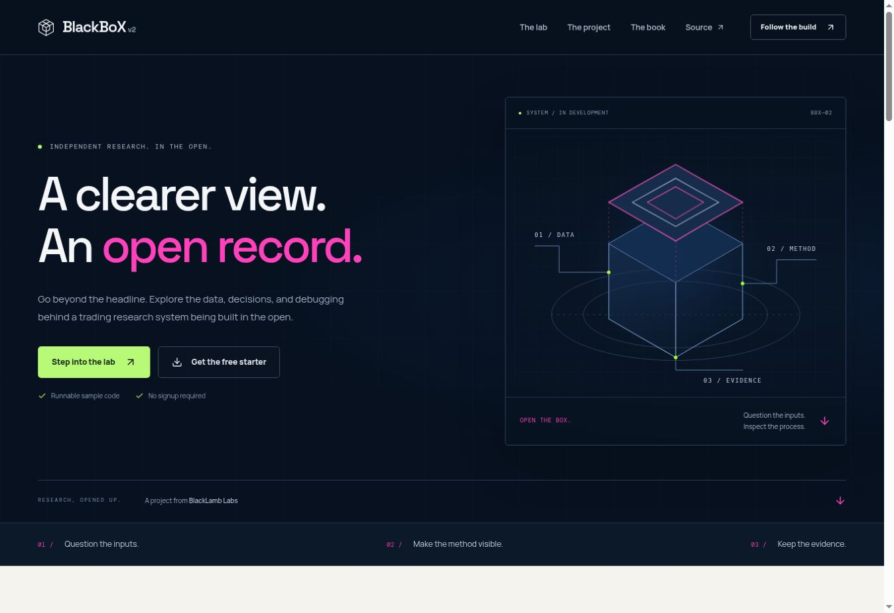

# BlackBoXv2

Website for the BlackBoX research project.

## Functional website preview

[Open the private preview](https://blackbox-research.blacklamb-1638.chatgpt.site/) — owner ChatGPT sign-in is required.

The proposed full-stack app lives in [web/](web/README.md). It includes a responsive website, interactive synthetic threshold lab, free Python/CSV/journal downloads, research notes, and an email interest list backed by D1.

The root static site is preserved. The new app needs a Worker-compatible host and D1; GitHub Pages alone cannot run its signup API. See [build notes](web/BUILD_NOTES.md) for checks and remaining launch work. Payments and email delivery are not enabled.
